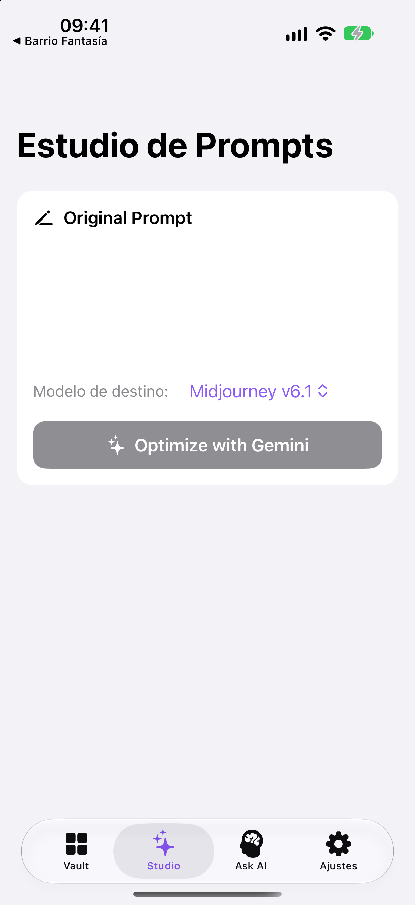
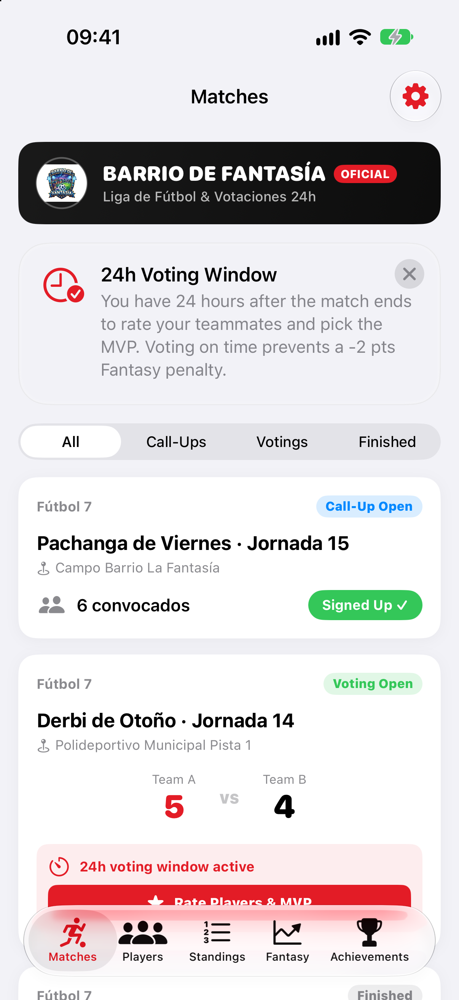

# Barrio de Fantasía (iOS Native)

<p align="center">
  
</p>

<p align="center">
  <strong>Native iOS application for neighborhood soccer leagues, match call-ups, 24-hour peer ratings, interactive 2D pitch formations, and Fantasy management.</strong>
</p>

<p align="center">
  
  
  
  
  
  
</p>

---

## ⚽ Highlights

- **Bilingual Internationalization (String Catalogs)**: Automatically presents the UI in **Spanish** for Spanish-speaking devices and seamlessly falls back to **English** for any other device language worldwide.
- **24-Hour Peer Rating System**: Fair-play matchday ratings (1.0 to 10.0 scale) and unanimous MVP election. Includes preventive local notifications 2 hours prior to deadline to avoid -2 pts Fantasy penalties.
- **2D Interactive Tactical Pitch (`SoccerPitchView`)**: Geometric lawn pitch rendered with turf cut stripes, boundary markings, and dynamic player nodes positioned by tactical role (GK, DEF, MID, FWD) with haptic feedback.
- **Performance Analytics (Swift Charts)**: Catmull-Rom historical rating curves with reference `RuleMark` lines indicating career average ratings.
- **Official Match Report PDF Export (`MatchReportPDFService`)**: A4 formatted editorial match sheets with lineups, scoreboard, and ratings table generated natively with `PDFKit` and shareable via `ShareLink`.
- **Zero-Friction Onboarding & Social Sign-In**:
  - **Sign in with Apple** (`AuthenticationServices`): Instant 1-tap sign-in with Face ID.
  - **Google Sign-In**: Clean web-authenticated OAuth session (`ASWebAuthenticationSession`) without heavy third-party SDK bloat.
  - **Squad QR Invites & Short Codes**: Quick 6-character squad join code (e.g. `BF-87X9`) and high-resolution QR code generator (`CIQRCodeGenerator`).
  - **Deep Linking**: `barriofantasia://join?code=XYZ` support for 1-click WhatsApp/iMessage invitation links.
- **Biometric Security (Face ID / Touch ID)**: Optional `LocalAuthentication` vault protection for private votes and lineup tactical sheets.
- **Full Vault JSON Backup (`VaultBackupService`)**: Export and backup player statistics and matchday archives via standard `Transferable` representations.

---

## 📱 Screenshots

<p align="center">
  
  &nbsp;&nbsp;&nbsp;&nbsp;
  
</p>

---

## 🏛️ Technical Architecture

| Layer | Implementation | Description |
|---|---|---|
| **Language** | Swift 6.0 | Strict concurrency checking, `@MainActor` isolation, `Sendable` domain models. |
| **UI Framework** | SwiftUI (iOS 17+) | Declarative views with `@Observable` ViewModels and `@Environment(\.locale)` dynamic injection. |
| **Persistence** | SwiftData | Clean schema models (`Player`, `Match`, `MatchVote`, `FantasyManager`, `Achievement`). |
| **Data Visualizations** | Swift Charts | Native `LineMark`, `PointMark`, and `RuleMark` statistical graphing. |
| **Authentication** | Apple & Google OAuth | Native `SignInWithAppleButton` + `ASWebAuthenticationSession`. |
| **System Frameworks** | Apple Native | `PDFKit`, `TipKit`, `LocalAuthentication`, `UserNotifications`, `CoreImage`. |
| **Project Automation** | XcodeGen | Clean, declarative, reproducible `project.yml` Xcode project generation. |

---

## 🛠️ Building & Running

### Requirements
- macOS 14.5+ (Apple Silicon recommended)
- Xcode 16.0+ (or Xcode 27.2)
- [XcodeGen](https://github.com/yonaskolb/XcodeGen) (`brew install xcodegen`)

### Quick Setup

```bash
# 1. Clone the repository
git clone https://github.com/Wacko87/barrio-fantasia-ios.git
cd barrio-fantasia-ios

# 2. Generate the Xcode project
xcodegen generate

# 3. Open in Xcode
open BarrioFantasia.xcodeproj
```

### CLI Build & Simulator Execution

```bash
# Build with xcodebuild
xcodebuild -project BarrioFantasia.xcodeproj \
           -scheme BarrioFantasia \
           -destination "platform=iOS Simulator,name=iPhone 18 Pro" \
           clean build

# Run in Spanish
xcrun simctl launch booted com.barriofantasia.app -AppleLanguages '(es)' -AppleLocale 'es_ES'

# Run in English (or test automatic non-Spanish fallback)
xcrun simctl launch booted com.barriofantasia.app -AppleLanguages '(en)' -AppleLocale 'en_US'
```

---

## 🛡️ Privacy & App Store Compliance

- **Zero Tracking**: `NSPrivacyTracking: false` declared in `PrivacyInfo.xcprivacy`.
- **Required-Reason APIs**: Documented `CA92.1` reason for `UserDefaults` storage.
- **Permissions**: Clear, localized usage descriptions for `NSFaceIDUsageDescription` and `NSPhotoLibraryUsageDescription` in `InfoPlist.xcstrings`.
- **App Store Review Guideline 2.1**: Full offline autonomy with pre-loaded demo rosters and match records via `DemoDataLoader` — Apple reviewers can test 100% of the app without backend credentials.

---

## 📄 License

This project is licensed under the [MIT License](LICENSE).
